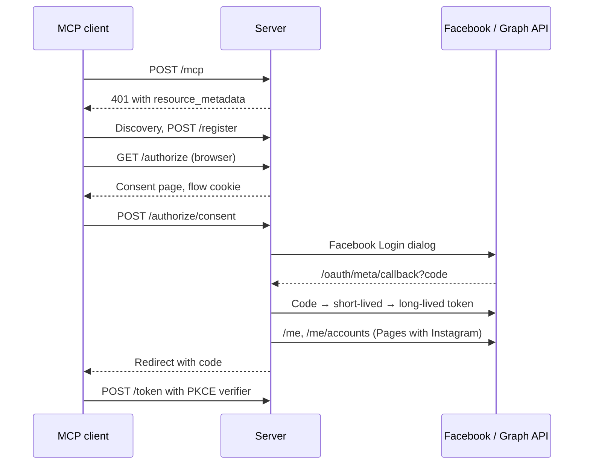

# Architecture Notes

## Module map
- `src/domain`: `Tenant`, `Session`, `Credential`, validated identifiers, `Media`, `Profile`, insights types and defaults, and `analytics::media_stats`.
- `src/instagram`: `InstagramService` and the `InstagramStore` port.
- `src/oauth`: authorization server. `service.rs` owns every protocol decision, `routes.rs` and `bearer.rs` are transport, `seal.rs` is the only cryptography.
- `src/mcp`: tools and DTOs.
- `src/meta`: `GraphApi` (HTTP, `appsecret_proof`, error classification), `MetaInstagramStore`, `MetaIdentity`.
- `src/app.rs`: wiring and the router.

## Key flows

Onboarding:

Tool call: `bearer::require_session` opens the access token and puts the
`Session` (tenant + Meta credential) in the request extensions. The tool reads
it through `Extension<Parts>` and passes it to `InstagramService`, which
resolves `account` against the tenant and calls `InstagramStore` with the
session's credential.

Refresh: the refresh token carries the Meta token. `/token` tries to extend it
(`fb_exchange_token`), keeps it if Meta declines, re-reads `/me` and
`/me/accounts`, and refuses a different user.

## Boundary rules
- The Graph API is reached only through `GraphApi`. Tokens go in the
  `Authorization` header; OAuth calls that need the app secret use
  `get_public`, whose errors drop the URL.
- Hashtag ids are cached per (account, hashtag) for 24 hours, so repeated
  lookups do not spend the weekly budget twice.
- Insight requests fall back to one metric at a time when Meta rejects a
  batch, and report the refused metrics as `unavailable`.
- Reports read at most `MAX_SAMPLE` media; caption search reads at most
  `MAX_SCAN`.

## Where mapping occurs
- Graph API rows ↔ domain: `src/meta/mapping.rs`.
- Tool arguments ↔ domain, domain ↔ tool results: `src/mcp/dto.rs`.
